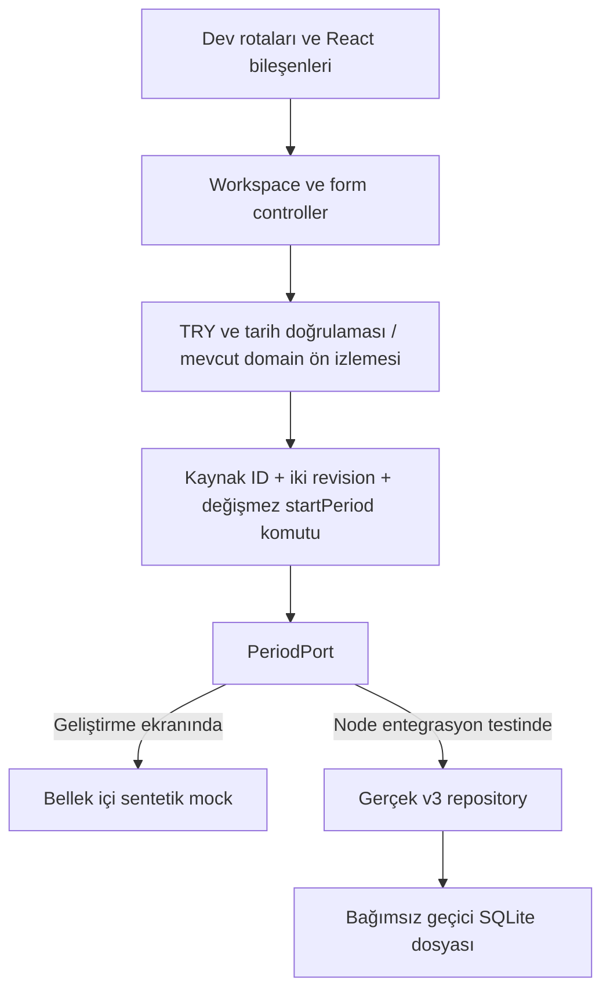

# Günlük Bütçem — 7C dönem arayüzleri

7C'nin yeni dönem formu, dönem geçmişi ve salt okunur arşiv arayüzleri geliştirildi. Çalışan uygulama **hâlâ v2 üzerinde**. Yeni akış yalnız `__DEV__` açıkken, ayrı ön izleme rotalarında ve sentetik bellek verisiyle kullanılabilir. Gerçek iPhone veritabanı açılmadı, v3 migration çalıştırılmadı. Yeni dönem ekranları üretim girişine veya mevcut ana ekrana bağlanmadı.

## Ekranlar ve erişim

Geliştirme sunucusundaki adres: `http://localhost:8093/dev-periods`.

| Rota | İçerik |
| --- | --- |
| `/dev-periods` | Sona ermiş örnek dönem, yeni dönem formuna giriş ve dönem geçmişi bağlantısı. |
| `/dev-periods/new?bookId=…&periodId=…&publicId=…` | Kaynak döneme sabitlenen form, seçilen faturalar, hesaplama ön izlemesi ve iki ayrı onay. |
| `/dev-periods/history` | Yeni kapanan dönem en üstte olacak şekilde arşiv listesi, kapanış bakiyesi, harcama/fatura/iptal bilgileri. |
| `/dev-periods/archive/[periodId]?bookId=…&publicId=…` | Kayıtlı kapanış sonucu, başlangıç/bitiş, faturalar ve aktif/iptal harcamalar. Salt okunur. |

Her ekranda “Yalnızca örnek veriler” açıklaması bulunur. Örnek saat 04.11.2026'dır; gerçek bugünün veya kullanıcının finansal durumunun yerine sunulmaz. Sayfa/uygulama tamamen yeniden yüklendiğinde sentetik oturum sıfırlanır. Ekranlar arasında gidip gelmek oturumu ve bekleyen denemeyi sıfırlamaz.

`dev-periods/_layout.tsx`, üretimde provider'ı oluşturmadan `/` rotasına yönlendirir. Provider gerçek repository açılışını kullanmaz: yalnız `createFixturePeriodPort` oluşturur. Yeni UI kaynaklarında `expo-sqlite`, native veritabanı açıcı veya migration çağrısı yoktur. İzolasyon yalnız bir dosya adı tercihiyle sağlanmıyor; gerçek veri bağlantısı bulunmuyor.

## Yeni dönem formu

Bakiye, yeni maaş tarihi ve birikim alanları başlangıçta boştur. Faturalar başlangıçta seçili değildir; bakiye veya gelir otomatik aktarılmaz. Sıfır ve negatif bakiye kabul edilir. Negatif harcanabilir tutar ve bütçe açığı gizlenmez.

TRY dönüşümleri mevcut `parseTurkishMoney` ile yapılır; tam sayı kuruş hassasiyeti korunur. Ondalık virgül ve doğru binlik grupları kabul edilir. Eksik/geçersiz/taşmış değerler ve iki ondalıktan fazla tutarlar reddedilir. Görselleştirmede mevcut Hermes uyumlu `formatMinorTRY` kullanılır; BigInt, `Intl.NumberFormat` veya native sayı işlemlerine aktarılmaz.

Her fatura için açık seçim ve ayrı vade düzenleme alanı vardır. **7B sözleşmesine uygun olarak isim ve tutar kaynak faturadan aynen kopyalanır; bu aşamada düzenlenebilen fatura alanı vadedir.** Yeni tutar/isim override'ı eklenmedi. Eski fatura yerinde kalır; seçilenler yeni kimliklerle ve kaynak bağlantısıyla kopyalanır. Maaş günündeki veya sonrasındaki vade reddedilir. Ödenmemiş eski vade bilinçli olarak korunabilir.

Ön izleme mevcut `createSetupPreview` adaptörü ve `calculateBudget` motoruyla hesaplanır. Yalnız kullanıcının yeni bakiye/birikim girdileri ve seçtiği faturalar verilir; yeni dönemin transaction listesi boştur. Kaynak bakiyesi, eski harcamalar veya maaş geliri eklenmez. Hesaplamak dönem oluşturmaz.

Ön izlemeden sonra kullanıcı iki ayrı onay verir: bakiyenin güncel/kullanılabilir olması ve eski dönemin değiştirilemez biçimde arşivlenecek olması. Finansal bir alan veya fatura seçimi değişirse önceki ön izleme ve onaylar geçersizleşir. Günlük tutar “öneri” olarak sunulur; kesin harcama güvenliği vaat edilmez.

Mevcut açık renkler ve yeşil palet, kartlar ve form alanları kullanıldı. Ekranlar SafeAreaView, KeyboardAvoidingView ve kaydırılabilir içerik içerir. Butonlar en az 54, seçim satırları en az 52 birim yüksekliğindedir. Alan etiketleri, hata açıklamaları, checkbox/busy/disabled erişilebilirlik durumları ve ön izleme anonsu eklendi. Bunların gerçek iPhone klavyesi/VoiceOver ve büyük yazı boyutlarıyla doğrulanması henüz yapılmadı.

## Ekrandan repository'ye veri akışı

UI, SQL veya veritabanı dosyası açmaz. React `useSyncExternalStore` ile controller/resource durumuna abone olur. Odak etkileri yalnız okuma yapar; render, yeniden render veya odaklanma `startPeriod` çağırmaz. Yazma yalnız kullanıcının oluşturma butonundan `controller.save()` üzerinden başlar.

Formun `bookId`, yerel dönem ID'si ve public ID'si rota açılışında bağlanır. Sayı/tür sınırları ve tekrarlı URL parametreleri doğrulanır. Aktif dönem eşleşmiyorsa başka döneme otomatik bağlanılmaz. Controller kaynaktaki period revision'ı ve book activation revision'ını komuta ekler. 7B'nin transaction/CAS/makbuz kuralları değiştirilmedi.

İlk kayıt dokunuşunda kilit senkron olarak alınır; ID üretimi ve diğer await'lerden önce `saving` durumu yayımlanır. Hızlı ikinci dokunuş aynı Promise'i alır. İşlem ID'si, hedef public ID ve fatura kopyası kimlikleri deneme boyunca korunur. ID üretiminin ortasında hata olsa bile alınmış işlem ID'si kaybolmaz.

Başarı yalnız `startPeriod` Promise'i tamamlanınca gösterilir. Node testinde bu çağrı gerçek transaction commit'inden sonra döner. UI mock'unda ise yalnız simüle edilen işlemin tamamlandığını belirtir; gerçek SQLite kalıcılığı izlenimi oluşturmaz.

Kayıt/yanıt hatasında girdiler, ön izleme ve değişmez deneme korunur. Sonuç belirsizken finansal içeriği değiştirmek yerine aynı işlemle yeniden kontrol edilir; yeni ID ile kendiliğinden tekrar başlanmaz. Yeniden denemede yalnız doğrulama saati ilerler, ekonomik komut değişmez. Yanıt kaybolduktan sonra aynı komutun kalıcı makbuzdan tanınması 7B'nin sorumluluğudur ve mevcut testleri korunmuştur.

`CONFLICT` halinde eski kaynak ve girdiler değiştirilmez. Kullanıcı önce “Değişiklikleri incele” der. Kaynak hâlâ aynı dönemse güncel veriyi forma alma açık bir kullanıcı işlemidir; seçimler/onaylar sıfırlanır, para/tarih metinleri korunur ve yeni ön izleme istenir. Aktif dönem farklıysa eski form onunla devam edemez; kullanıcı ayrı aktif dönem ekranını açmalıdır. Eski veriler yeni komuta taşınmaz.

Workspace formları dönem kapsamı anahtarıyla saklar. Ekrandan ayrılma, geri dönme veya yeniden render aynı controller'ı kullanır; pending kayıt yeniden başlatılmaz. Geç gelen okuma yanıtları yeni okumayı veya başarılı kayıt durumunu ezmez.

## Dönem geçmişi ve arşiv

7B repository'sine yalnız okuma yapan `listClosedPeriods(bookId)` eklendi. Defter ve `status='closed'` kapsamında parametreli sorgu kullanır, `closed_at DESC, id DESC` sıralar. Her dönem mevcut `readPeriodV3` ile kendi kapanış anı/sürümü üzerinden doğrulanır. Bugünün saati verilmez. Bozuk veya bilinmeyen sürümlü arşiv sessizce atlanmaz; hata döner. Şema ve finansal yazma kuralları gevşetilmedi.

Arşiv bileşeni yalnız dönem verisini alır; düzenleme/iptal callback'i yoktur. Ekranın kaynak aldığı resource yazma metodu sunmaz. Arşiv sunumu saat parametresi almaz, `calculateBudget` çağırmaz ve sadece saklanan sonucu biçimlendirir. Harcamalar yeni tarihten eskiye, ayrı gerçekleşme/kayıt zamanlarıyla gösterilir. İptaller çizili tutar, durum ve iptal zamanı ile görünür. Başlangıç bakiyesine dahil kayıtlar ayrıca işaretlenir.

Gösterilen harcama toplamı `spentSinceSnapshotMinor` değeridir: başlangıç anından sonraki aktif harcamalar. İptaller ve başlangıç bakiyesinden önceki/tam o andaki hareketler ikinci kez düşülmez. Faturalar ad, tutar, vade ve varsa taşıma kaynağı bilgisiyle sunulur. Boş liste ve boş harcama durumları vardır.

## Dosyalar

Değişen mevcut dosyalar yalnız şunlardır:

- `src/data/budget/v3-contracts.ts`: salt okunur geçmiş listeleme metodu.
- `src/data/budget/repository-v3.ts`: geçmiş okuyucusuna bağlama.
- `tsconfig.budget-tests.json`: yeni saf UI modüllerini test derlemesine dahil etme.

Yeni kaynak ve test dosyaları:

| Dosya | Görev |
| --- | --- |
| `src/data/budget/v3-history.ts` | Defter kapsamlı, doğrulanmış arşiv okuma. |
| `src/app/dev-periods/_layout.tsx` | Üretim kapısı ve izole provider. |
| `src/app/dev-periods/index.tsx` | Ön izleme başlangıcı. |
| `src/app/dev-periods/new.tsx` | Yeni dönem formu, onay ve sonuç. |
| `src/app/dev-periods/history.tsx` | Dönem listesi. |
| `src/app/dev-periods/archive/[periodId].tsx` | Salt okunur dönem detayları. |
| `src/features/periods/contracts.ts` | UI port, form tipleri ve rota kapsamı doğrulaması. |
| `src/features/periods/form.ts` | Formdan domain ön izlemesine adaptör. |
| `src/features/periods/form-controller.ts` | Asenkron kayıt, deneme kimliği ve conflict/inceleme akışı. |
| `src/features/periods/resource.ts` | Okuma/yüklenme/hata ve geç yanıt denetimi. |
| `src/features/periods/workspace.ts` | Navigasyondan bağımsız form/resource kaydı. |
| `src/features/periods/fixture-port.ts` | Açıkça mock olan, bellekte sentetik veri ve hata senaryoları. |
| `src/features/periods/preview-provider.tsx` | Yalnız geliştirmede oluşturulan oturum. |
| `src/features/periods/hooks.tsx` | React aboneliği ve odak okumaları. |
| `src/features/periods/period-ui.tsx` | Ortak görsel bileşenler, seçimler ve özet. |
| `src/features/periods/presentation.ts` | Saatten bağımsız arşiv biçimlendirmesi. |
| `tests/period-ui/fixtures.ts` | UI test yardımcıları. |
| `tests/period-ui/form.test.ts` | TRY, tarih ve fatura ön izlemesi. |
| `tests/period-ui/controller.mock.test.ts` | Çift dokunma, async, hata, retry ve conflict. |
| `tests/period-ui/navigation.mock.test.ts` | Geri dönüş, geç yanıt, rota, üretim kapısı ve salt okunurluk. |
| `tests/period-ui/repository.sqlite.test.ts` | Gerçek dosyada UI → v3 repository entegrasyonu. |

Bu raporla birlikte `raporlar/7c-test-sonuclari.txt`, `7c-dogrulama.json`, `7c-export.txt`, `7c-audit-tam.json`, `7c-audit-uretim.json` eklendi. Görev başındaki 113 kaynak/test/yapılandırma/rapor dosyasının 110'u aynıdır; diğer üçü yukarıda açıklandı. Bütün eski testler, v1/v2/v3 migration'lar, domain motoru, paket kilidi, ana uygulama rotaları ve native v2 açıcı değişmeden kaldı. Üretilen Expo rota tipi önbelleği araç tarafından güncellendi, elle düzenlenmedi.

## Test sonuçları ve gerçek sınırları

| Kontrol | Sonuç |
| --- | --- |
| `npm test` | **420/420 geçti.** Önceki 376 + yeni 44. 0 başarısız, 0 atlanan. |
| Yeni UI mock/adaptör/controller testleri | 38 geçti. Gerçek native dokunma veya render testi değildir. |
| Yeni gerçek SQLite entegrasyon testleri | 6 geçti. Node.js 24.4.0 / SQLite 3.50.2, bağımsız geçici dosyalar. |
| Önceki native API mock testleri | Mevcut 3 test korundu; gerçek native sürücü kanıtı sayılmaz. |
| `npx tsc --noEmit` | Geçti. Testler ayrıca kendi TypeScript yapılandırmasıyla derlendi. |
| `npx expo lint` | 0 hata, 0 uyarı. Kural kapatılmadı. |
| `npx expo-doctor` | 20/20 geçti. |
| `npx expo export --platform all --max-workers 2 --output-dir /private/tmp/gunluk-butcem-7c-export` | iOS/Android Hermes bytecode ve web istemci/sunucu paketleri üretildi. |
| Gerçek iPhone/Android ve native SQLite | **Yapılmadı.** İmzalı IPA/APK veya cihaz E2E testi yok. |
| Otomatik Browser görsel/etkileşim testi | **Yapılamadı.** Bağlı Browser listesi boş kaldı. |
| Kullanıcı teyidi | Kullanıcı, başlangıç sayfasında “Yeni bir döneme, temiz bir başlangıç.” başlığını gördüğünü bildirdi. Diğer UI adımlarının otomatik doğrulaması sayılmadı. |

Mock testleri boş/negatif/sıfır bakiye, kuruş sınırları, virgül, fatura seçimi ve vadesi, iki onay, preview geçersizleştirme, çift dokunma kilidi, commit yanıtını bekleme, ID üretim hatası, kayıt/yanıt kaybı, aynı kimlikle retry, conflict ve açık inceleme, eski form, navigasyon ve geç gelen yanıtları kapsar.

Gerçek SQLite testleri boş/sıralı/defter kapsamlı geçmiş, saklanmış kapanış, eski harcamaların ve iptallerin gösterimi, form tutarlarının gerçek `startPeriod` komutuna ulaşması, eski dönem isteğinin reddi, gerçek transaction rollback sonrası aynı komutla retry ve bozuk arşivin hata olarak gösterilmesini kapsar. Yeni testlerde kullanıcı verisi veya native sürücü kullanılmadı.

Browser becerisi kullanılarak bağlantı kurulmaya çalışıldı. [Okunan Browser talimatı](</Users/emre/.codex/plugins/cache/openai-bundled/browser/26.623.101652/skills/control-in-app-browser/SKILL.md>) “Do not use external MCP browser-control tools, separate browser automation servers, or other browser skills for this surface.” der. Bağlantı yokken başka bir tarayıcı otomasyonuna geçilmedi. Ekran görüntüsü, otomatik tıklama veya küçük ekran görsel QA yapılmış gibi raporlanmıyor. Paket üretimi de gerçek cihaz davranışını garanti etmez.

## Deneme adımları

1. Geliştirme adresini açıp “Yeni dönem oluştur · Ön izleme”yi seçin.
2. Bakiye `3.000,25`, maaş tarihi `04.12.2026`, birikim `500,00` yazın.
3. Kira'yı seçip vadesini `28.11.2026` yapın; Elektrik'i seçmeyin.
4. Ön izleme: bakiye ₺3.000,25; fatura ₺2.000,00; birikim ₺500,00; harcanabilir ₺500,25; 30 gün; günlük öneri ₺16,67.
5. İki onayı verip örnek dönemi oluşturun. Sonuçtan arşive gidin; iptal edilmiş kayıtları da görün.
6. Yeni senaryo için sayfayı tamamen yenileyin. “Kayıt hatası”, “Veri değişikliği” veya “Yanıt kaybı” seçimi yalnız sıradaki örnek denemeyi etkiler. Yanıt kaybında aynı işlemle tekrar kontrol edin. Conflict'te güncel veriyi açıkça inceleyip faturaları/onayları yenileyin.

## Devam eden güvenlik bulguları

Tam audit ve `--omit=dev` taraması aynı **5 yüksek** paket bulgusunu döndürdü; 0 kritik, orta ve düşük. Komutların çıkış kodu 1 bulgu bulunmasından kaynaklanır. Yeni bağımlılık eklenmedi; paket sürümleri değişmedi.

| Paket / sürüm | Zincir ve etki |
| --- | --- |
| `node-forge 1.4.0` | Expo → CLI → node-forge; bazı RSA PKCS#1 v1.5 doğrulamalarında gerekli saldırı koşulları altında sahte imzanın kabulü/bütünlük riski. [Bildirim](https://github.com/advisories/GHSA-86w9-cpqp-85rv). |
| `zod 3.25.76` | Expo → CLI → Zod; büyük koleksiyon doğrulamasında aşırı bellek tüketimi/hizmetin durması riski. [Bildirim](https://github.com/advisories/GHSA-mrhx-c7xc-m3w5). |
| `@expo/code-signing-certificates 0.0.7` | CLI → sertifika paketi → node-forge; imza/sertifika doğrulama zincirinden etkileniyor. Ayrı üçüncü bir kök bildirim değil. |
| `@expo/cli 58.1.15` | İmza doğrulama ve DevTools doğrulama zincirleri üzerinden iki kök bulgunun etkisini taşıyor. Paket kilidindeki konumu `node_modules/expo/node_modules/@expo/cli`. |
| `expo 58.0.19` | Normal bağımlılık olarak CLI'yi içerdiğinden üretim bağımlılığı taramasında da etkilenmiş görünüyor. Mobil ikilide istismar kanıtı anlamına gelmez. |

Riskli alt koda saldırgan girdisinin ulaşabilmesi ayrıca gerekir; bu görev istismar veya native saldırı yüzeyi analizi değildir. Expo 58 uyumlu resmî, hedefli düzeltmeler değerlendirilmelidir. Audit'in Expo 44.0.6 önerisi uygulanmadı. `audit fix`, `--force`, toplu yükseltme veya override yapılmadı. Önceki ayrıntılı `GUVENLIK_RAPORU.md` ve yeni ham audit dosyaları korunuyor.

## Tamamlanan kapsam ve sonraki aşama

7C'nin form/ön izleme/onay, dönem geçmişi, salt okunur arşiv, hata/yeniden deneme ve navigasyon durumları izole geliştirme katmanında tamamlandı. Native v3 kalıcılığı doğrulanmış gerçek kullanıcı akışı bu teslimatın parçası değildir.

Gerçek iPhone'da v3'ü etkinleştirmeden önce:

- Ayrı sentetik native v1/v2 dosyalarında migration, v3 repository, exclusive bağlantı/FK, commit/rollback, yarış ve yeniden açılış doğrulanmalı.
- Uygulamanın zorla kapanması, arka plan, WAL kurtarma, disk/yazma hatası, büyük arşiv hacmi ve yanıt kaybı native sürücüde test edilmeli.
- Küçük iPhone/Android, klavye, geri navigasyon, VoiceOver/TalkBack ve büyük yazı boyutları gerçek UI'da doğrulanmalı; otomatik görsel inceleme de tamamlanmalı.
- Fixture provider yerine gerçek v3 port adaptörü kontrollü biçimde bağlanmalı; sentetik veri ve test senaryosu kontrolleri gerçek akışa taşınmamalı.
- v2 → v3 dağıtımı, eski sürüm uyumluluğu ve WAL ile tutarlı yedek/geri yükleme planı doğrulanmalı. Kullanıcının açık onayı olmadan gerçek dosyada migration çalıştırılmamalı.

Bu aşamada bunlara veya başka bir bütçe özelliğine geçilmedi. SQLite şifreleme, otomatik bulut yedeği ve cihazlar arası senkronizasyon eklenmedi.
