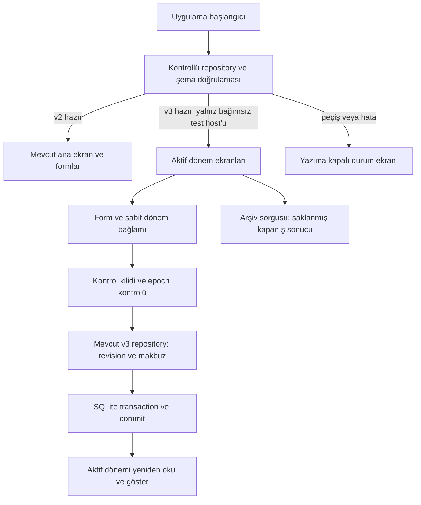

# Günlük Bütçem — 7D-3 üretim entegrasyonu raporu

Tarih: 26 Ekim 2026. Karar: **bağımsız iOS entegrasyon provası için GO; gerçek kullanıcı verisinde v3 etkinleştirmesi için NO-GO.**

Kontrollü başlangıç, yazma kilidi, doğrulanmış kopyaya geçiş, kurtarma ve ekran entegrasyonu tamamlandı. `npm test`: **459/459**, başarısız ve atlanan test yok. Önceki 442 test korunuyor; bu aşamada 17 üst test eklendi. Gerçek iPhone/Expo Go/Hermes üzerinde son altyapı turu **10/10** başarılı. Ekranlardan sentetik yeni dönem oluşturma, arşiv, harcama ve iptal akışı ayrıca doğrulandı.

Gerçek kullanıcı veritabanı bu çalışma sırasında açılmadı. Ana uygulamada `allowV3: false`, `autoUpgrade: false` ve `user-v2-only` dosya kapsamı sürüyor. Gerçek kayıtlar üzerinde v3 migration, dosya silme, yeniden adlandırma veya sıfırlama yapılmadı. Bağımlılık ve sürüm değişikliği yapılmadı.

## 1. Kontrollü başlangıç ve erişim

`src/data/budget/platform.native.ts` tek bir uygulama repository örneği döndürüyor. Ekranlar doğrudan SQLite veya ham v2/v3 repository açmıyor; `BudgetApplicationProvider` üzerinden bu örneği kullanıyor.

Başlangıç durumları `idle → opening → ready` veya `upgrading/recovering/blocked`. İlk doğrulama bitene kadar finansal ekranlar bağlanmıyor. Sonradan geçiş/kurtarma olursa mevcut ekran ağacı görünüm ve erişilebilirlikten çıkarılıyor; geçici form state'i korunuyor. Yeniden render, focus veya ekran yükleme finansal komut başlatmıyor.

`ApplicationBudget` mevcut ekran modeline ek olarak şu erişim bağlamını taşır:

```ts
type BudgetAccess = Readonly<{
  epoch: number;
  schema: 2 | 3;
  bookId: number;
  activationRevision: number;
  period: Readonly<{ id: number; publicId: string; revision: number }> | null;
}>;
```

Komut oluşturulduğunda bu bağlam ve parasal payload kopyalanıyor. Repository beklerken çağıranın nesneyi değiştirmesi komutu değiştiremiyor. v3 yazmalarında eksik bağlam reddediliyor; eski dönemin bağlamı yeni aktif döneme otomatik uyarlanmıyor. Dönem kimliği, dış kimliği, revision ve aktivasyon revision kontrolleri mevcut v3 repository'de de uygulanıyor.

Her finansal işlem seçili dosyanın `PRAGMA user_version` değerini kontrol ediyor. v2 repository'nin v3 dosyada veya v3 repository'nin v2 dosyada çalışması engelleniyor. Bilinmeyen sürüm, bozuk kontrol kaydı veya eksik dosya boş kurulum gibi kabul edilmiyor.

### Ayrı kontrol veritabanı

Finansal v1/v2/v3 şemaları değiştirilmedi. Açılış koordinasyonu için ayrı kontrol dosyasının **kendi şema sürümü 1** oluşturuldu:

| Tablo | Alanlar ve amaç |
| --- | --- |
| `runtime_state` | Tek satır `id=1`; güvenli tam sayı `epoch`; şema 2/3; aktif dosya anahtarı; `ready/pending`; bekleyen işlem ve dosya öneki |
| `runtime_transitions` | Benzersiz işlem kimliği ve önek; kaynak epoch; `pending/activated/recovered`; hedef dosya anahtarı |

Tablolar `STRICT` ve CHECK/UNIQUE kısıtları kullanır. Okunan veriler ayrıca doğrulanır: v3 işaretçisiyle eşleşen aktivasyon makbuzu bulunmalı; aktif v3 makbuzu varken işaretçi sessizce v2'ye dönememeli; bekleyen durumun eşleşen işlem kaydı bulunmalı. Kontrol dosyasının bilinmeyen sürümünde de sıfırlama yoktur.

Normal uygulama bu kodla ileride açıldığında bütçe dosyası `gunluk-butcem.db` v2 kalır; koordinasyon metadatası `gunluk-butcem-control.db` dosyasındadır. Bu çalışma gerçek uygulama girişini çalıştırmadı. Native üretim dosya adaptörü bu aşamada yedek/aday dosya oluşturmayı ayrıca reddeder. Bir URL veya ortam değişkeni bu sınırı açamaz.

## 2. Eşzamanlı yazma ve geçiş

Tek JS örneğindeki sıra tek başına yeterli değildir. İkinci repository/bağlantı için kontrol veritabanında yazıcı kilidi alınır:

```sql
UPDATE runtime_state SET epoch=epoch WHERE id=1;
```

Bu ifade kontrol durumunu okumadan önce çalışır ve transaction bitene kadar SQLite yazıcı kilidini tutar. Expo'nun exclusive transaction bağlantısında kullanılan deferred BEGIN sonrasında yalnız SELECT yapmak, WAL altında diğer yazıcıları durdurmaya yetmez. Bu yüzden Node testi de kontrol dosyasında deferred BEGIN kullanır. SQLite'ın tek eşzamanlı yazıcı davranışı temel alınmıştır. [SQLite transaction belgesi](https://www.sqlite.org/lang_transaction.html)

Geçiş sırası:

1. Yerel durum hemen `upgrading` olur; yeni finansal komutlar reddedilir.
2. Kontrol yazıcı kilidi mevcut kabul edilmiş işlemlerin tamamlanmasını bekler. `pending` geçiş niyeti ayrı transaction ile **kalıcı olarak commit edilir**.
3. Yeni kontrol transaction'ı yazıcı kilidini tutar; niyet/epoch tekrar doğrulanır. Diğer kontrollü repository örnekleri bu sırada yazamaz.
4. Kaynak v2 şeması, kayıtları ve domain geçerliliği okunur. Mevcut WAL uyumlu `prepareV3Copy` kullanılır: yedek → yeniden okuma → bağımsız geri yükleme → doğrulama → aday dosya → mevcut tek transaction v3 migration → yeniden açma/doğrulama.
5. Bütçe, faturalar, aktif/iptal/geçmiş harcamalar, yerel kimlikler ve işlem makbuzları karşılaştırılır. Kaynak şema ve kayıtlarının değişmediği tekrar denetlenir. Özel finansal karşılaştırma verileri log veya rapor alıcısına gönderilmez.
6. Doğrulanan adayın anahtarı ve yeni epoch kontrol dosyasında CAS ile değiştirilir; aktivasyon makbuzu aynı transaction içinde kesinleşir.
7. Ancak kontrol COMMIT'i başarıyla döndükten sonra durum `ready/3` olur; v3 ekranları açılır.

Yedekleme dosyanın yalnız `.db` kısmını kopyalamaz; mevcut Expo SQLite `backupDatabaseAsync` altyapısı kullanılır. Bağımsız geri yükleme dosyası da okunarak doğrulanır. [Expo 58 SQLite API](https://docs.expo.dev/versions/v58.0.0/sdk/sqlite/), [SQLite Backup API](https://www.sqlite.org/backup.html)

### Atomiklik sınırı

Bu işlem birden fazla dosyayı kapsadığı için **yedek + migration + aktif işaretçi tek SQLite transaction'ı değildir**. Aday finansal dosyanın migration'ı kendi tek transaction'ındadır. Geçiş niyeti önceden commit edilir; dosya hazırlığı sonrasında işaretçi ve aktivasyon makbuzu kontrol dosyasında birlikte commit edilir. Kaynak dosya yerinde v3'e çevrilmez ve dosya yeniden adlandırılmaz.

Kaynak v2 dosyası korunurken yeni yazmalar yalnız aktif aday dosyaya gider. Geçişten sonra eski kontrollü v2 referansı epoch/şema çiti nedeniyle yazamaz. Finansal kayıt commit edildikten sonra kontrol transaction'ı veya yanıtı hata verebilir; bu durumda başarı gösterilmez ve aynı işlem kimliğiyle makbuz kontrolü/tekrar güvenlidir. Diskler arası genel atomiklik veya tüm eski uygulama sürümlerine karşı koruma iddiası yoktur.

## 3. Hata ve kurtarma davranışı

| Hata noktası | Sonuç ve yeniden açılış |
| --- | --- |
| Yedek eksik, bozuk veya kaynakla farklı | Aktivasyon yok; kopyalar korunur, gerçek kaynak üzerine geri yükleme yapılmaz |
| Aday migration veya aday doğrulaması başarısız | UI `blocked`; kısmi aday normal veri kabul edilmez |
| Aday hazır, aktif işaretçi henüz commit edilmedi | Kalıcı `pending` niyet kalır; sonraki açılış v2 kaynağı doğrular, işlemi `recovered` yapar ve v2'de durur; o açılışta otomatik yeniden yükseltme yok |
| Aktif işaretçi COMMIT'inden önce kontrollü hata | İşaretçi transaction'ı geri alınır; yeniden açılış doğrulanmış v2'yi seçer |
| İşaretçi commit oldu, başarı yanıtı kayboldu | İlk deneme başarı göstermez; yeniden açılış aktivasyon makbuzu ve adayla v3'ü bulur, migration'ı tekrarlamaz |
| Bilinmeyen şema, eksik aktif kopya, bozuk makbuz/işaretçi | Güvenli hata; veri silme, eski yedeğe sessiz dönüş veya sıfırdan kurulum yok |
| Önceden var olan kontrol dosyası yanında kaynak şema 0 | Eksik kaynak yerine yeni boş bütçe oluşturulmaz; açılış engellenir |

Kullanıcıya açılış/geçiş/kurtarma mesajı ve “Güvenli açılışı yeniden dene” seçeneği gösterilir. Kaynağın kendisi doğrulanamıyorsa uygulama veri onarımı uydurmaz; inceleme gerekir. Kaynakta daha yeni veriler bulunabileceği için eski yedek otomatik olarak kaynağın üstüne yazılmaz.

İlk kontrol dosyası kurulumu ile ilk v2 bootstrap da ayrı commit'lerdir. Tam bu arada kesinti olursa korumacı eksik-kaynak kontrolü nedeniyle manuel inceleme gerekebilir. Boş bütçe üretmek yerine durma tercihi bilinçlidir; bu kenar durum için üretim öncesi destek/kurtarma prosedürü tamamlanmalıdır.

## 4. Ekran entegrasyonu ve veri akışı



Ana ekran, bütçe ayarları ve harcama/iptal işlemleri ortak uygulama modelini kullanır. v3 erişimi doğrulanmadıkça kayıtlı dönem bağlantıları gösterilmez. `/periods` doğrudan açılmaya çalışılsa bile v2 host'u kayıtlı v3 portu vermez. `/dev-periods` sentetik ön izleme olarak ayrı kalır.

Harcama formu ilk açıldığı döneme bağlanır. Focus yenilemesi başka aktif dönem getirse bile eski form yeni döneme geçirilmez. İnceleme/tekrar deneme yalnız aynı dönem için yapılabilir. Ayar kaydı da ilk okunan bağlamı taşır; eski revision veya kapanmış dönem reddedilir. Harcama geçmişi olan dönemde başlangıç bakiyesi ve maaş tarihi kilidi korunur.

7C yeni dönem formu ve arşiv ekranları yeniden yazılmadı; kayıtlı/demo portları ve rota aileleri ayrıldı. Aynı komutta retry kimliği korunur. CONFLICT sonrası inceleme kabul edilip bilgiler yeniden onaylanırsa eski niyet temizlenir, yeni kimlik oluşturulur. Çift dokunma aynı Promise'i paylaşır; commit öncesi başarı yoktur. Mevcut 7C retry, loading, conflict, navigasyon ve salt okunur arşiv testleri aynen geçti.

Arşiv sorguları `loadClosedPeriod/listClosedPeriods` kullanır. Eski sonuç bugünün tarihiyle tekrar hesaplanmaz. Domain motoru, para biçimlendirme hassasiyeti ve INTEGER kuruş yaklaşımı değiştirilmedi.

## 5. Gerçek iPhone kanıtı ve dokunulamayan lab ekranı

Bağlantı **8103** üzerinde, slug `gb-v3-integration`, farklı uygulama kimliği `dev.gunlukbutcem.integration7d3`. Test dosyaları `gb-v3-integration` alt dizininde `gb-app-<rastgele-kimlik>-...` adlarıyla oluşturulur. Her altyapı senaryosu yeni kimlik alır; kullanıcı dosyaları temizlenmez. Eski **8097** lab'ından bildirilen sonuç 7D-3 başarısı olarak sayılmadı.

Başlık göründüğü hâlde düğmelerin çalışmamasının gerçek nedeni: test UI fixture'ında maaş günü bugüne alınırken faturalar 28/29 Ekim'de bırakılmıştı. Domain fatura tarihini maaştan sonra bulup `checkLegacyData` sırasında `INVALID_DATA` ile açılışı durduruyordu; Router Stack henüz bağlanmamıştı. Gerçek kayıtlarda veya motorda değişiklik yapılmadı. Tüm sentetik tarihler birlikte kaydırıldı; 26 Ekim, yılbaşı ve artık yıl sınırı için üç test eklendi. Hatalı sentetik dosya silinmedi; yeni test kimliği kullanıldı. Lab başlığı artık açılış bitene kadar gezinmeyi açıkça devre dışı gösterir; düğmeler en az 44 puan yüksekliğindedir.

Son gerçek iPhone turu: **10 geçti, 0 başarısız**, Hermes ve fiziksel cihaz doğrulandı, native SQLite **3.53.3**. Cihazın HTTP raporu: kaynak şema **2**, aktif aday şema **3**, kontrol epoch **2**, aktivasyon makbuzu sayısı **1**. Bu metrikler yalnız bağımsız test dosyalarına aittir.

Kanıt: [son cihaz HTTP raporu](raporlar/7d3-ios-native-http-1793043858303-0058d2.json), [aynı turun native tanılama kaydı](raporlar/7d3-ios-native-mvpo0nxo-3ed774e4.json).

| Native senaryo | Sonuç |
| --- | --- |
| Açılışta fixture v2 → doğrulanmış v3; tekrar açılışta migration tekrarı yok | Geçti |
| İki repository/bağlantı; migration sırasında yazma çiti | Geçti |
| Önceden başlamış harcamanın tamamlanıp yedeğe dahil edilmesi | Geçti |
| Değiştirilmiş yedeğin reddi | Geçti |
| Kontrollü migration hatası ve v2'ye güvenli yeniden açılış | Geçti |
| Aktivasyon commit'inden önce hata/rollback | Geçti |
| Commit başarılıyken yanıtın kaybolması ve v3'ü tekrar açma | Geçti |
| Gerçek form adaptörleri, yeni dönem, seçili fatura, harcama/iptal retry ve arşiv | Geçti |
| v2 host'unda v3 kapalı; ayar, harcama, iptal, retry ve kalıcılık | Geçti |
| Bilinmeyen şemada durma; sıfırlama yok | Geçti |

Aynı on senaryonun tekrar turları ek test sayısı gibi toplanmadı. Önceki 7D-1/7D-2 cihaz sonuçları bu turun içine eklenmedi.

### Gerçek ekran akışı

Fiziksel iPhone üzerinde gerçek paylaşılan React Native ekranları ve mevcut olay işleyicileri kullanıldı. Otomasyon React DevTools ağacından form ve düğme işleyicilerini çağırdı; bu fiziksel ekran koordinatlarına dokunma veya klavyeyle yazma otomasyonu değildir.

1. Yeni dönem formunda bakiye **boş** başladı.
2. Bakiye `3.000,25`, birikim `500,00`, maaş tarihi `26.11.2026` girildi; yalnız `2.000,00` TL fatura seçildi.
3. Ön izleme: **500,25 TL** harcanabilir, **31 gün**, günlük **16,13 TL**. İki ayrı onaydan sonra dönem kaydedildi; eski dönem arşivi açıldı.
4. Yeni döneme `100,01` TL sentetik harcama girildi. Harcanabilir tutar **400,24 TL** oldu.
5. Native iptal onay penceresinde kullanıcı fiziksel olarak **“Kaydı iptal et”** seçeneğine bastı. Kayıt iptal durumuyla korundu, harcanabilir tutar **500,25 TL** oldu.
6. Kullanıcı Expo Go'yu tamamen kapatıp yalnız 8103 test girişini yeniden açtı. Yeni dönem, iptal kaydı ve aynı tutar okundu. Dönem ekranı henüz sona ermemiş B dönemi için yeni dönem açmayı engelledi.
7. Kullanıcı son dokunma kontrolünde “Ana ekran”, “Dönemler” ve “Testler” düğmelerinin üçünün de fiziksel dokunmayla ilgili ekranları açtığını doğruladı. Bu teyit yalnız bu üç gezinme düğmesini kapsar.

Kanıtlar: `raporlar/7d3-ios-ui-*.json`. Bunlar yalnız sentetik içerikli render ağacı kayıtlarıdır; ekran görüntüsü veya tam manuel görsel onay değildir. Navigator'ın önbellekte tuttuğu görünmeyen ekran metinlerini de içerebilir.

Expo Go ayrı işletim sistemi uygulama sandbox'ı sağlamaz. Buradaki güvenlik sınırı özel slug, bağımsız giriş, kısıtlı dosya adaptörü, alt dizin ve rastgele dosya kimliğidir. Ayrı imzalı sandbox kurulumu henüz yapılmadı.

## 6. Testler ve platform ayrımı

| Kontrol | Sonuç ve kapsam |
| --- | --- |
| `npm test` | **459/459**, 0 hata, 0 atlanan. Node 24.4.0. Önceki 442 test dosyası içerik olarak korunuyor |
| Node gerçek SQLite | Mevcut migration/repository/prova testleri + 16 yeni üst test. Node SQLite **3.50.2**, bağımsız gerçek dosyalar, WAL ve deferred kontrol transaction'ı. Ortak on senaryo bu üst testlerden birinin içinde; ayrıca 10 test olarak toplam sayıya eklenmedi |
| Mock/saf fonksiyonlar | Önceki form/controller/çatışma/navigasyon mock testleri ve domain testleri geçti. Yeni web `UNSUPPORTED` testi sahte store kullanır; gerçek web SQLite testi değildir |
| Gerçek iOS SQLite/Hermes | Son ortak altyapı turu **10/10**; gerçek ekran akışı, kullanıcı native Alert onayı ve uygulamayı kapatıp açma ayrıca doğrulandı |
| Gerçek Android | **Çalıştırılmadı**; bağlı Android/adb yok |
| Manuel arayüz | Kullanıcı lab'ı açtı, native iptal onayına bastı, uygulamayı kapatıp açtı ve “Ana ekran”, “Dönemler”, “Testler” düğmelerinin fiziksel dokunmayla çalıştığını doğruladı. Bütün form alanlarının fiziksel klavye/dokunma, VoiceOver ve farklı ekran boyutlarıyla manuel testi tamamlanmadı |
| `npx tsc --noEmit` | Başarılı, çıkış 0 |
| `npx expo lint` | Başarılı, çıkış 0 |
| `npx expo-doctor` | **20/20**, çıkış 0 |
| Ana uygulama iOS/Android/web `expo export` | Başarılı, çıkış 0; native Hermes bytecode ve web paketleri. İmzalı IPA/APK/AAB veya native cihaz testi sayılmaz |
| Taşınabilir bağımsız proje iOS/Android export | Başarılı, çıkış 0. Farklı kimlikli internal build hazırlığı; imzalı kurulum yapılmadı |

Node SQLite'ın deneysel API uyarısı ve paket üretimindeki `NO_COLOR/FORCE_COLOR` uyarısı loglarda korunmuştur; test hatası yoktur. Kod kapsamı çıktısı React ekranlarının veya Expo native modülünün bütünüyle test edildiği anlamına gelmez.

Loglar: [testler](raporlar/7d3-test-sonuclari.txt), [Node ortak senaryolar](raporlar/7d3-node-sqlite.json), [TypeScript](raporlar/7d3-typescript.txt), [ESLint](raporlar/7d3-eslint.txt), [Doctor](raporlar/7d3-expo-doctor.txt), [ana paketler](raporlar/7d3-paket-uretimi.txt), [bağımsız proje paketleri](raporlar/7d3-bagimsiz-proje-paket-uretimi.txt).

### Henüz kanıtlanmayan davranışlar

Gerçek cihazda migration/COMMIT anında OS kill, güç kesintisi, fiziksel dolu disk ve gerçek donanım I/O arızası uygulanmadı. Kontrollü throw, bozuk yedek ve kayıp commit yanıtı gerçek SQLite transaction'larında sınandı; bunlar fiziksel arızanın tüm davranışını kanıtlamaz. Önceki Node alt süreç kesinti testleri iOS/Android OS kill testi olarak sayılmadı.

Tam Xcode/simülatör araçları ve Android cihaz araçları mevcut değil. EAS imzalı internal/release derlemesi, TestFlight/Play kurulum ve güncelleme testi yapılmadı. Üretim için Apple/Android imzalama, ayrı EAS proje/kimlik ayarı, dağıtım profilleri ve gerçek release binary testleri gerekiyor. [Expo internal dağıtım belgesi](https://docs.expo.dev/build/internal-distribution/)

`node scripts/prepare-integration-lab.mjs --portable --no-register` kaynakları geçici bağımsız projeye kopyalar; uygulama kimlikleri ve `preview` internal profili üretir. `--no-register` mevcut 8103 cihaz girişini değiştirmez. Kopya paket kilidi mevcut sürümleri korur; ana package/lock değiştirilmez. EAS yükleme/derleme başlatılmadı. `expo-dev-client` eklenmedi.

## 7. Beş yüksek npm audit bulgusu

Tam audit ve `npm audit --omit=dev`: **5 yüksek, 0 kritik**. Audit komutunun çıkış 1'i bu bulgular nedeniyle beklenen sonuçtur; temiz audit gibi raporlanmadı. Beş kayıt beş bağımsız açık değildir: iki doğrudan güvenlik danışmanlığı, bağımlılık zincirinde üst paketlere de yansıyor.

| Paket / kurulu sürüm | İlişki | Risk ve mevcut kapsam |
| --- | --- | --- |
| `node-forge 1.4.0` | Transitif: `expo → @expo/cli → node-forge`; ayrıca `@expo/code-signing-certificates → node-forge` | RSA PKCS#1 v1.5 imza doğrulamasında hatalı ASN.1 kabulü. Saldırgan kontrollü imzanın etkilenen doğrulama yoluna ve uygun düşük üs anahtara ulaşması gerekir. İmza/sertifika geliştirme araçları açısından risk; mobil finansal akışta bu kütüphane kullanılmıyor |
| `zod 3.25.76` | Transitif: `expo → @expo/cli → zod`; ESLint araçlarında da başka bir yol var | Çok büyük koleksiyon doğrulamasında bellek tüketimi/servis dışı kalma. Güvenilmeyen büyük girdinin etkilenen şemaya ulaşması gerekir. CLI DevTools şemalarında array kullanımları var; gerçek sömürü gösterilmedi |
| `@expo/code-signing-certificates 0.0.7` | Transitif: `expo → @expo/cli → ...` | `node-forge` nedeniyle işaretli. Paket kaynaklarında sertifika/imza doğrulama çağrıları var; güvenilmeyen imza/sertifika doğrulamak araç zinciri riskidir |
| `@expo/cli 58.1.15` | Transitif: `expo → @expo/cli` | Yukarıdaki bağımlılıklar nedeniyle toplu bulgu. Geliştirme sunucusu, imzalama ve CLI araçlarını etkiler; cihaz paketindeki yalnız Metro modül yükleyicisi aynı güvenlik yolları değildir |
| `expo 58.0.19` | Doğrudan üretim bağımlılığı | CLI zincirinden yansıyan bulgu. Expo çalışma zamanı cihazda vardır; bu durum ilgili `forge/zod` açıklarının cihazda çalıştığını tek başına göstermez |

`node-forge` danışmanlığında etkilenen aralık `<=1.4.0`, yamalı sürüm listesi yoktur. [İmza doğrulama danışmanlığı](https://github.com/advisories/GHSA-86w9-cpqp-85rv)

`zod` danışmanlığı `<4.6.6` aralığını etkilenmiş sayar ve `4.6.6` yamasını gösterir; kurulu sürüm 3.x'tir. [Bellek tüketimi danışmanlığı](https://github.com/advisories/GHSA-mrhx-c7xc-m3w5)

Son üretim export'unun bütün kaynak haritaları tarandı: iOS, Android, web istemci ve web sunucuda **node-forge, zod ve code-signing-certificates kaynakları yok**. `@expo/cli` içinden yalnız `build/metro-require/require.js` bulunuyor; Expo çalışma zamanı mevcut. Bu nedenle bu iki açık için yayınlanan JS paketinde doğrudan bir çalışma yolu gözlenmedi. Bu, araç zincirinin risksiz olduğu veya henüz üretilmemiş imzalı native paketin denetlendiği iddiası değildir. `--omit=dev` çıktısının aynı kalmasının nedeni CLI'nin doğrudan `expo` paketinin bağımlılığı olmasıdır.

7D-2'den farklı olarak v3 migrator ve yedek hazırlama kodu artık ana JS paketinde bulunur; üretim host yetkisi ve dosya adaptörü gerçek veride etkinleşmesini kapatır. Test host'u/fixture'ları/UI tanılama sürücüsü ana pakette bulunmaz. Kanıt: [paket kaynak denetimi](raporlar/7d3-paket-kaynak-denetimi.json).

İncelenen Expo 58 kararlı sürümlerinde en güncel Expo `58.0.19`, CLI `58.1.15`; CLI hâlâ `node-forge ^1.4.0` ve `zod ^3.25.76` ister. SDK içinde doğrulanmış uyumlu bir çözüm bulunamadı. Audit'in önerdiği Expo `44.0.6` geçişi mevcut Expo 58 projesine uygun değildir. Zod'u zorla 4.x'e override etmek CLI sözleşmesini değiştirebilir. Öneri: Expo/CLI uyumlu düzeltmesini takip etmek ve geldiğinde ayrı testli değişiklik önermek; şu anda hiçbir paket yükseltilmedi, `audit fix` veya `--force` çalıştırılmadı.

Ham sonuçlar: [tam audit](raporlar/7d3-audit-tam.json), [üretim bağımlılıkları audit](raporlar/7d3-audit-uretim.json), [CLI sürüm bilgileri](raporlar/7d3-cli-surumleri.json), [Expo sürümleri](raporlar/7d3-expo-surumleri.json).

## 8. Değişen kod dosyaları

Çalışma başındaki 155 dosyanın içerik özetiyle karşılaştırma: **17 mevcut dosya değişti, 24 kod/test/script dosyası eklendi, eski dosya silinmedi.** Mevcut testler, domain, önceki migration ve v3 repository dosyaları ile `package.json/package-lock.json` içerikleri bu aşamada değişmedi. Git'te daha eski aşamalardan kalan değişiklikler bu çalışmanın değişikliği olarak sayılmadı. Makine çıktısı: [kapsam](raporlar/7d3-degisiklik-kapsami.json).

| Dosyalar | Değişiklik |
| --- | --- |
| `src/data/budget/application-contracts.ts`, `application-runtime.ts`, `application-view.ts` | Yeni kontrollü açılış, erişim bağlamı, v2/v3 UI adaptörü ve kurtarma |
| `src/data/budget/runtime-catalog.ts`, `runtime-store.native.ts` | Yeni kalıcı koordinasyon, native dosya yetkisi, WAL yedekleme; kapanan handle'ların takip koleksiyonlarından çıkarılması |
| `src/data/budget/platform.native.ts`, `platform.ts` | Ortak repository girişi; native gerçek akış v2, web açıkça desteklenmiyor |
| `src/features/application/provider.tsx`, `src/app/_layout.tsx` | Başlangıç kapısı ve repository bağlamı |
| `src/features/saved-budget/home-screen.tsx`, `budget-summary.tsx`, `use-saved-budget.ts`, `load-state.ts` | Ortak veri modeli, scoped iptal, schema-gated dönem bağlantıları ve hata durumları |
| `src/features/budget-setup/setup-screen.tsx` | İlk erişime bağlı kaydetme; eski dönemin formunu yeni döneme uygulamama |
| `src/features/expenses/expense-screen.tsx` | Sabit dönemli form, kontrollü retry/inceleme, gerçek v3 dönem bağlantısı |
| `src/features/periods/routes.ts`, `preview-provider.tsx`, `workspace.ts`, `form-controller.ts`, `period-ui.tsx` | Kayıtlı/demo portu, rota ve açıklama ayrımı; mevcut controller kurallarını koruma |
| `src/app/dev-periods/index.tsx`, `new.tsx`, `history.tsx`, `archive/[periodId].tsx` | Paylaşılan ekranların doğru port/rota ailesini kullanması |
| `src/app/periods/_layout.tsx`, `index.tsx`, `new.tsx`, `history.tsx`, `archive/[periodId].tsx` | Yeni kayıtlı dönem rota ailesi; yalnız doğrulanmış v3 erişimi |
| `src/devtools/application/host.native.ts`, `suite.ts`, `test-frame.tsx`, `ui-driver.ts`, `ui-fixture.ts` | Yalnız bağımsız test girişi, native senaryolar, güvenli sentetik tarihler ve UI tanılama |
| `tests/application/fixture.ts`, `runtime.sqlite.test.ts`, `full-suite.test.ts`, `ui-fixture.test.ts` | Yeni bağımsız SQLite ve açılış/dokunma sorunu regresyon testleri |
| `scripts/prepare-integration-lab.mjs`, `run-integration-lab.mjs`, `integration-report-receiver.mjs` | Ayrı kimlikli geçici proje, korumalı native kontrol ve kişisel veri içermeyen yerel sonuç alıcısı |

Bu rapor ve `raporlar/7d3-*` kanıt dosyaları da eklendi. Gerçek finansal veriler raporlanmadı; UI örnekleri yalnız sentetik lab'a aittir.

## 9. GO / NO-GO ve etkinleştirme öncesi kalanlar

**GO:** Aynı açılış/repository/ekran kaynaklarıyla bağımsız iPhone/Expo Go ortamında kontrollü v2→v3 provası; yazma çiti, yedek doğrulama, kurtarma, aktif dönem, arşiv ve harcama akışlarının bu raporda belirtilen kapsamı.

**NO-GO:** Gerçek kullanıcı dosyasında v3 etkinleştirme ve genel üretim yayını. Açık kalan teknik ve operasyonel kapılar:

1. Ayrı uygulama kimliğiyle imzalı iOS internal/release ve gerçek Android build/cihaz testi. Expo Go sonucunu imzalı pakete genellememek.
2. Native migration ve işaretçi commit'i sırasında kontrollü süreç sonlandırma, uygulama güncelleme/yeniden açılış, native düşük depolama/I/O hata provası. Güvenle yapılamayan fiziksel arızalar için kalan belirsizliği belgelemek.
3. Kaynak/kontrol/aktif aday/yedek dosyalarının birlikte korunacağı yedekleme ve destek prosedürü; yalnız kaynak v2 dosyasını taşımak artık v3 oturumunu taşımaz. Aktif v3 kaybolursa eski kaynak otomatik olarak güncel kabul edilmez.
4. Kontrol kataloğundan habersiz eski yayımlanmış uygulamaya geri dönüşü engelleyen sürüm politikası. Bu aşamadaki v2-only host aktifleştirilmiş kataloğu reddeder; önceki kontrolsüz binary'nin doğrudan eski kaynakta yazmasını bu katman tek başına engelleyemez.
5. Büyük harcama geçmişinde açılış süresi, kilit bekleme ve tam kayıt karşılaştırmasının bellek kullanımı için native ölçüm. Mevcut hazırlık kanıtı tüm kayıtları bellekte karşılaştırır; sınırsız büyüklükte veri testi yapılmadı.
6. Bekleyen UI komutlarının kimlikleri bu aşamada ekran/controller ömründe korunur. Uygulama tamamen kapanınca form/henüz gönderilmemiş niyet kalıcı değildir. Commit edilmiş veriler ve makbuzlar kalıcıdır; yeniden açılış finansal veriyi okur ve otomatik yeni komut üretmez. Süreçler arası aynı UI niyetini sürdürme ayrıca tasarlanmalıdır.
7. Beş yüksek audit bulgusu için Expo uyumlu çözüm veya açık risk kabulü; hiçbir zorlayıcı yükseltme yapılmadan yeniden değerlendirme.
8. Teknik kapılar tamamlandıktan sonra gerçek kullanıcı verisini kapsayan geçiş, üretim dosya yetkisinin açılması ve dağıtım için **ayrı, açık kullanıcı onayı**. Bugünkü hardcoded kapılar kaldırılmadı.

Bu aşamada duruldu. Gerçek kullanıcı veritabanı yükseltmesi, üretim bayrağının açılması ve başka ürün özelliği geliştirmesi başlatılmadı.
