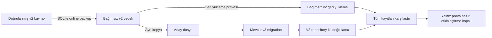

**Günlük Bütçem — 7D-2 güvenli etkinleştirme hazırlığı**

Tarih: 26 Ekim 2026.

**Karar: bağımsız prova için GO; gerçek kullanıcı verisinde v3 etkinleştirmesi için NO-GO.**

Hazırlık kodu, yedekleme/geri yükleme provası ve entegrasyon testleri tamamlandı. **442/442 otomatik test** başarılı. Fiziksel iPhone/Hermes, SQLite 3.53.3 üzerinde güncel test paketi **iki farklı dosya grubunda 33/33 ve 33/33** sonuç verdi. Bunlar gerçek kullanıcı veritabanında migration veya yayınlanacak uygulamanın kurulumu değildir.

Ana uygulama v2 kullanmaya devam ediyor. Gerçek `gunluk-butcem.db` bu görevde açılmadı, kopyalanmadı, değiştirilmedi veya silinmedi. v1/v2/v3 migration'ları, domain motoru ve repository kuralları değiştirilmedi. Paket kurulmadı/yükseltilmedi. 7D-1'in 426 testi aynen korundu; 16 yeni Node test kaydı eklendi.

**1. Tekrar çalıştırılabilen laboratuvar**

Eski 18 `LAB_FILE_ALREADY_EXISTS` sonucunun nedeni dosya korumasının bozuk olması değildi. `prepare-native-v3-lab.mjs` proje için bir kere `runId` oluşturuyordu. JS yeniden başladığında bellekteki “bu tur tamamlandı” kilidi kayboluyor, fakat aynı kimlik ve sabit test anahtarları yeniden kullanılıyordu. Sürücü boş olmayan dosyaları görünce migration'a başlamadan duruyordu.

Yeni davranış:

- Her açık “Yeni bağımsız test turu başlat” işlemi SQLite `randomblob(16)` ile yeni bir tur kimliği alır.
- Aynı anda iki dokunuş tek Promise'i paylaşır; ikinci tur kendiliğinden başlamaz.
- Her turun dosyaları `gb-v3lab-<tur-kimliği>-<test-anahtarı>.db` adını taşır. Çakışma halinde koruma hâlâ reddeder; mevcut dosyalar temizlenmez.
- Ayrı lab kontrol dosyasındaki `gb_lab_runs` tablosu yalnız sıra numarası, tur kimliği ve `running/passed/failed` durumunu saklar. Finansal satır içermez. Kimlik UNIQUE kısıtıyla korunur.
- Başarı sonucu, turun SQLite günlüğüne yazımı ve bağlantısının kapanması tamamlandıktan sonra görünür.
- Yeniden açılışta “Son başarılı turun kalıcılığını doğrula” işlemi bu günlüğü okur. Yarım veya başarısız bir tur tamamlanmış kabul edilmez.
- Render, mount, abonelik veya ekranı tekrar açmak test başlatmaz. Sonraki tam tur ancak açık komutla başlar.
- Kontrol dosyası da özel lab dizinindedir; gerçek bütçe açıcısı ve ana uygulama ekranları bu bağımsız Expo girişine alınmaz.

Native doğrulama önce iki adet 31 senaryolu turla yapıldı. İki ek olumsuz senaryo cihaza tam yeniden açılışla geldikten sonra güncel paket iki kez **33/33** geçti. Turların hepsi farklı kimlik kullandı; 7D-1 kanıtları üzerine yazılmadı. Node testinde ilk turun yaşam döngüsü dosyası ikinci turdan sonra tekrar karşılaştırıldı ve değişmemişti.

Lab dosyaları bilerek korunur; sık test çalıştırmak cihazdaki test dosyalarını artırır. Otomatik silme/temizlik eklenmedi. Böyle bir temizlik ileride yalnız sahipliği kanıtlanan lab dosyaları için ayrıca tasarlanabilir.

**2. Yedekleme ve kurtarma tasarımı**

Seçilen yaklaşım: **kaynağı koru, yedeği doğrula, başka bir kopyayı yükselt**. Yerinde migration yerine hazırlık aşamasında bağımsız kopya kullanmak, migration başarıyla commit edilmiş fakat yanıt kaybolmuş olsa bile v2 kaynağın değişmeden kalmasını sağlar.

Bu aşamada şemadaki “kaynak” **sentetik v2 fixture dosyasıdır**. Gerçek kullanıcı veritabanına bağlanan bir üretim adaptörü veya açılış entegrasyonu eklenmedi. Hazırlık fonksiyonu yalnız enjekte edilen dosya yeteneklerini kullanır; gerçek dosya adı, silme, terfi ettirme veya sıfırlama API'si içermez.

`prepareV3Copy` sırasıyla:

1. Kaynak sürümün tam 2 olduğunu, beklenen dört tabloyu ve finansal verileri doğrular. Bilinmeyen sürüm veya geride kalmış staging tablosunu kabul etmez.
2. Kaynağın mantıksal şemasını ve bütün eski sütunlarını bellekte tutar. Finansal kanıtlar UI'ya, loglara veya telemetriye gönderilmez.
3. Yeni yedek dosyayı SQLite online backup API'siyle oluşturur. Native uygulamada `backupDatabaseAsync` kullanılır. Yedek kapatılıp tekrar açılır.
4. `integrity_check`, `foreign_key_check`, mevcut domain doğrulaması, şema ve bütün kayıtların tam eşitliğini kontrol eder. Yalnız kayıt sayısına veya toplam bakiyeye güvenmez.
5. Yedeği üçüncü bağımsız dosyaya geri yükler; bunu da kapatıp yeniden açarak aynı doğrulamaları yapar.
6. Doğrulanmış yedekten başka bir aday dosya oluşturur ve mevcut `migrateDatabaseV3` fonksiyonunu yalnız bu adayda çalıştırır.
7. Adayı yeniden açar; v3 bütünlüğünü, bütün eski sütunların korunmasını ve mevcut v3 repository ile bütçenin okunmasını doğrular.
8. Kaynağı tekrar karşılaştırır. Prova sırasında başka bir yazar değişiklik yaptıysa aday hazır kabul edilmez; yeni kaynak eski yedekle geri çevrilmez.
9. Bütün kopya bağlantılarını kapatır. Kapatma hatası da başarıya dönüştürülmez.

Başarılı sonuç bile `mode:'rehearsal-only'`, `activationAllowed:false` taşır. Dosyanın mevcut veya `user_version=3` olması tek başına açılışta kullanılmasına yetmez.

WAL açıkken ham `.db` dosyası kopyalanmaz; commit edilmiş WAL içeriğini kapsayan SQLite backup API'si kullanılır. Kaynakta WAL modu ve checkpoint davranışı testte ayarlanmıştır. Native backup çağrısı açık bir migration transaction'ının içine yerleştirilmez. [Expo 58 SQLite API](https://docs.expo.dev/versions/v58.0.0/sdk/sqlite/), [SQLite online backup açıklaması](https://sqlite.org/backup.html).

Yedek şifrelenmez; SQLCipher, bulut yedeği veya senkronizasyon eklenmedi. Karşılaştırma tam mantıksal eşitliktir; kriptografik imzalı bir yedek/manifest sistemi iddia edilmez. Yeniden açılış doğrulaması, bellekteki eski bir başarı bayrağına güvenmek yerine v2 kaynak ve bütün kopyaları tekrar okur.

**Üretimde ayrıca gerekenler:** Bütün yazıcıların durdurulması, açık bağlantıların yönetilmesi, yeterli depolama alanı, dayanıklı geçiş günlüğü ve adayın aktif dosya olarak seçilmesi için atomik/CAS kontrollü bir açılış kataloğu gerekir. Bunlar bu görevde gerçek uygulama açılışına bağlanmadı. Kaynağı son kez karşılaştırmak, daha sonra başlayabilecek başka bir yazıcıyı tek başına engellemez; yazıcı kilidi ileride etkinleştirme tamamlanana kadar tutulmalıdır.

**Kurtarma akışı**

| Durum | Uygulanan davranış |
| --- | --- |
| Yedek eksik, açılamıyor veya satırları farklı | Aday migration'a geçilmez; `blocked` sonucu döner. |
| Geri yükleme kopyası farklı | Migration'a geçilmez; yedek başarıyla oluşmuş olsa da hazırlık engellenir. |
| Migration transaction'ı hata veriyor | Adaydaki değişiklikler mevcut atomik migration ile geri alınır. Orijinal sentetik v2 kaynak ayrıca karşılaştırılır. |
| Commit tamam, yanıt kayıp | Başarı uydurulmaz; durum engellenir. v3 aday korunur, v2 kaynak değişmez. Yeniden inceleme gerekir. |
| Aday version 2, eksik/yanlış şema veya açılış hatası | Dosya otomatik onarılmaz, sıfırlanmaz veya aktif seçilmez. |
| Kaynak prova sırasında değişti | `manual-review-required`; yeni kaynak eski yedekle ezilmez. |
| Kaynak v2 hâlâ tam doğrulanabiliyor | `source-v2-verified`; mevcut v2 akışına devam edilebilir, yeni prova yeni dosyalarda yapılır. |
| Kaynak da doğrulanamıyor | Güvenli hata durumu; yeni bütçe kurulumuna yönlendirme ve sıfırlama yapılmaz. |

Buradaki kurtarma, çalışan kaynağın üzerine otomatik yedek yazmayı içermez. Başarısız hazırlıkta kaynak zaten v2 kalır. Gelecekte aktif v3'e yeni harcamalar yazıldıktan sonra eski v2 yedeğe otomatik dönmek yeni kayıtları kaybettirebilir; böyle bir geri dönüş bu mimaride güvenli kabul edilmez.

**3. Geçiş provası ve veri karşılaştırması**

33 native senaryonun ilk 19'u 7D-1 migration/yaşam döngüsü kontrolleridir. Bunlara 14 hazırlık kontrolü eklenmiştir:

- WAL üzerinde başarılı yedek → yeniden açma → geri yükleme → v3 aday → yeniden inceleme.
- Eksik yedek; mantıksal olarak değiştirilmiş yedek; yedek yazma hatası.
- Geri yüklenmiş kopyada farklı fatura tutarı.
- Prova sırasında eşzamanlı kaynak değişikliği; eski kaynağın geri yazılmasının engellenmesi.
- Migration'ın kopyalama, tablo değiştirme, koruyucular ve sürüm yazımı aşamalarında dört gerçek transaction rollback denemesi.
- Commit sonrası yanıt kaybı.
- Adayın yanlış sürümle yeniden açılması.
- Eski v2 repository üzerinden bütçe okuma ve harcama iptalinin çalışması; kaynak değişince eski hazırlığın geçersiz olması.
- 7C form controller/workspace → gerçek v3 repository → arşiv sunum katmanı entegrasyonu.

Fixture'da dönem kimliği ve revision, iki fatura, aktif ve iptal harcamalar, başlangıçtan önceki ve tam başlangıç anındaki harcamalar, eski opak işlem makbuzu bulunur. Şema ve **bütün eski sütunlar** karşılaştırılır. Eski bakiyeye dahil harcamaların yeniden düşülmediği ve yeni dönemin açıkça girilen 3.000,25 TL ile başladığı da doğrulanır. Yeni ekranda seçilen faturanın rezervi sonrası 500,25 TL harcanabilir tutar beklenir.

Ek Node dosya testleri fiziksel olarak 23 bayta kesilmiş bozuk yedeği, boş v2 bütçeyi, sürüm 1/3/99 reddini ve geride kalmış staging tablosunu kapsar. Fiziksel dosya kesme deneyi **iPhone'da yapılmadı**; native'de mantıksal bozulma ve yazma hatası senaryoları çalıştı.

**4. Ekranlar ve güvenli açılış**

7C ekranları hâlâ geliştirme ön izlemesine ve fixture sağlayıcısına bağlıdır; gerçek ana ekran bunlara geçirilmedi. Yeni testte aynı mevcut controller/workspace gerçek bağımsız v3 SQLite repository ile kullanıldı. TRY dönüşümü, seçili fatura, çift dokunma, başarı öncesi commit bekleme sözleşmesi, kaydedilen arşiv, iptal durumu ve yeniden mount sonrası ikinci komut oluşturmama kontrol edildi. Arşiv yeniden okunduğunda dosyada yazım olmadığı karşılaştırıldı.

Gerçek v2 ana ekranında açılış hatası ile boş veritabanı ayrımı küçük, test edilebilir bir modüle çıkarıldı:

- `MIGRATION` ve `INVALID_DATA` için kayıtları silmeden açılışın durdurulduğunu açıklayan Türkçe hata görünür.
- Başarısız ilk okuma, `saved:null` olarak gösterilmez ve kurulum ekranına yönlendirmez.
- Başarısız yenileme son iyi bütçeyi korur.
- Kurulum yalnız başarılı bir okumada bütçe bulunmadığında açılır.
- Hata ekranına silme/sıfırlama düğmesi eklenmedi. Mevcut tekrar deneme yalnız mevcut v2 açılışını tekrar dener.

Otomatik açılışta veritabanını silme/yeniden oluşturma yakalayıcısı yoktur; native açıcı dosyası değiştirilmedi. Şablondan kalan `reset-project` komutu uygulama açılışına bağlı değildir ve çalıştırılmadı. v3 migration'daki mevcut DROP ifadeleri yeni adayın atomik tablo yeniden yapılandırmasının parçasıdır; kaynak v2'de çalıştırılmadı.

**5. Test kanıtları ve kapsam farkları**

| Katman | Sonuç | Sınır |
| --- | --- | --- |
| Node toplam | **442/442**, 0 başarısız, 0 atlanan | Önceki 426 kayıt aynen korundu. |
| Gerçek Node SQLite | İki farklı kimlikle **33/33 + 33/33**, önceki tur verisi korunuyor | Bu iki tur bir yeni Node test kaydının içindedir; 442'ye tekrar eklenmez. |
| Mock | Yeni 4 lab koordinatörü testi ve mevcut mock testleri başarılı | ID tahsisi, çift dokunma, journal commit bekleme, başarısız tur ve remount. |
| Güvenli açılış modeli | 5 yeni test başarılı | RN ekranına bağlanan durum/karar fonksiyonlarıdır; dokunma/klavye testi değildir. |
| Gerçek iPhone SQLite/Hermes | Güncel paket **33/33 + 33/33**, SQLite 3.53.3 | Ayrı sentetik dosyalar; gerçek kullanıcı kaydı yok. |
| Yeniden açılış | Expo Go kapatılıp açılınca yeni JS runtime son başarılı 31'lik turun journal kaydını buldu; yedek ve aday yeniden doğrulandı | Native PID izlenmedi; COMMIT sırasında süreç öldürme testi değildir. Son 33'lük tur için aynı runtime'da kapat/aç doğrulaması ayrıca geçti. |
| 7C entegrasyonu | Node ve gerçek iPhone SQLite üzerinde controller/workspace/repository/presenter başarılı | Yeni dönem/arşiv ürün ekranlarına gerçek cihazda elle dokunma testi yapılmadı. |
| Gerçek Android | Çalıştırılmadı | Bağlı cihaz/adb yok. |
| TypeScript / ESLint | Başarılı | Son kaynaklar kontrol edildi. |
| Expo Doctor | **20/20** | Paket ve SDK uyumu. |
| iOS / Android / web export | Başarılı | İmzalı IPA/APK oluşturma, kurma veya native SQLite doğrulaması değildir. |

Expo Go'nun SDK 58 native modülü ve Hermes'i üzerinde gerçek SQL çalıştırıldı. Yayınlanacak uygulama ise kendi sandbox'ı, native yapılandırması, build seçenekleri, `__DEV__=false` davranışı ve paketlenmiş JavaScript'iyle ayrıca test edilmelidir. Bu görevde imzalı development/release build kurulmadı. Expo Go testi bu boşluğu kapatmaz.

Native kanıtlar:

- [Güncel birinci 33'lük tur](raporlar/7d2-ios-native-a1ca5c99375bcf9ac472bb1fc6a38884.json)
- [Güncel ikinci 33'lük tur](raporlar/7d2-ios-native-f27de463f2720631e16580ec48768d33.json)
- [Yeni JS runtime'da journal ve kopyaların bulunması](raporlar/7d2-ios-resume-3fe740c011dccd272f600bb331fbf027.json)
- [Son turun dosyalarını yeniden açma](raporlar/7d2-ios-resume-f27de463f2720631e16580ec48768d33.json)
- [Node SQLite turları](raporlar/7d2-node-sqlite.json), [442 test çıktısı](raporlar/7d2-test-sonuclari.txt)
- [TypeScript](raporlar/7d2-typescript.txt), [ESLint](raporlar/7d2-eslint.txt), [Doctor](raporlar/7d2-expo-doctor.txt), [export](raporlar/7d2-paket-uretimi.txt)

**6. Güvenlik ve yayınlanan kod**

Yeni `npm audit` ve `npm audit --omit=dev` sonuçlarının ikisi de **5 high**, 0 critical. Bu nedenle çıkış kodları 1; hata gizlenmedi ve fix çalıştırılmadı. Aynı iki advisory beş paketi etkiliyor:

| Paket | Zincir / risk |
| --- | --- |
| `expo` 58.0.19 | Doğrudan bağımlılık; CLI'nin transitif açıkları nedeniyle işaretleniyor. |
| `@expo/cli` 58.1.15 | Expo → CLI; forge/Zod/sertifika araçlarının üst paketi. |
| `@expo/code-signing-certificates` 0.0.7 | Expo → CLI → certificates → forge; sertifika/imza doğrulaması. |
| `node-forge` 1.4.0 | CLI → forge ve certificates → forge; düşük üs kullanan RSA anahtarlarında saldırgan imza girdisiyle sahte imza kabulü riski. |
| `zod` 3.25.76 | Expo → CLI → Zod; çok büyük geçersiz doğrulama dizileriyle bellek tükenmesi riski. |

Advisory'ler: [forge](https://github.com/advisories/GHSA-86w9-cpqp-85rv), [Zod](https://github.com/advisories/GHSA-mrhx-c7xc-m3w5). 7D-1'de incelenen CLI sertifika doğrulaması ve DevTools eklenti çıktısı yolları bu araç zincirinde bulunduğundan bulgular yok sayılmaz. Finansal formlar Zod/forge kullanmaz. Saldırgan kontrollü sertifika veya çok büyük DevTools çıktısı gibi araç girdileri ayrı risk yüzeyidir; bu projede gerçek exploit gösterilmedi.

Son export kaynak haritaları yeniden tarandı: iOS 1.596, Android 1.692, web istemci 1.260, web sunucu 1.293 kaynak. Forge/Zod/sertifika modülleri bu grafikte bulunmadı. CLI'nin `metro-require/require.js` yükleyicisi bulundu; dolayısıyla bütün CLI'ye “yalnız geliştirme kodu” denmedi. `--omit=dev` sonucunun hâlâ beş olması, bu paket zincirinin Expo'nun production dependency ağında bulunmasıyla uyumludur; etkilenen yolların native JS paketine girdiğinin kanıtı değildir. Bu statik grafikte doğrudan çalışma zamanı erişimi bulunamadı; imzalı uygulama için güvenlik garantisi verilmez. Sunucu dış bağımlılıkları ayrıca değerlendirilmelidir.

Aynı taramada **lab, yeni hazırlık fonksiyonu ve v3 migrator ana uygulama paketinde bulunmadı**; native v2 açıcı yerinde kaldı. Hazırlık yanlışlıkla üretim başlangıcına alınmamıştır.

Expo 58 uyumunu korumak için paketler değiştirilmedi. Zod 4.6.6+ kök advisory için düzeltme içerir, ancak CLI'nin 3.x sözleşmesine zorlanması uygun patch değildir; forge advisory'sinde 1.4.0 için henüz yama belirtilmiyordu. Desteklenen Expo/CLI düzeltmesi doğrulanmadan override veya Expo 44'e audit tarafından önerilen düşürme uygulanmamalıdır. [7D-1 ayrıntılı sürüm incelemesi](NATIVE_V3_DOGRULAMA_RAPORU.md).

Kanıtlar: [tam audit](raporlar/7d2-audit-tam.json), [dev hariç audit](raporlar/7d2-audit-uretim.json), [yeni paket grafiği](raporlar/7d2-paket-kaynak-denetimi.json).

**7. Değişen dosyalar**

Mevcut altı dosya:

- `src/devtools/native-v3/driver.native.ts`: yeniden açılışta doğrulanabilecek hazırlık dosyalarının sahiplik listesi.
- `src/devtools/native-v3/runtime.native.ts`: yeni tur koordinatörü, kalıcı journal, hazırlık suite'i ve yeniden açılış doğrulaması.
- `src/devtools/native-v3/lab-app.tsx`: yeni tur/son başarılı tur ayrımı ve tur kimliği gösterimi.
- `scripts/run-native-v3-lab.mjs`: 7D-2, tur kimliği ve benzersiz yakalama kimliğiyle ayrı kanıt dosyaları; mevcut çıktının üzerine yazım reddedilir, 7D-1 çıktıları korunur.
- `src/features/saved-budget/use-saved-budget.ts`: ortak, test edilmiş açılış hata modeli.
- `src/features/saved-budget/home-screen.tsx`: yalnız başarılı boş okumada kurulum kararı.

Yeni dokuz kaynak/test dosyası:

- `src/data/budget/upgrade-evidence.ts`: v2/v3 bütünlük ve tam kayıt karşılaştırması; hassas kanıtlar bellekte.
- `src/data/budget/upgrade-preparation.ts`: yedek, restore, aday migration ve güvenli engelleme akışı.
- `src/devtools/native-v3/coordinator.ts`: test edilebilir tur kilidi/kimliği/durum makinesi.
- `src/devtools/native-v3/journal.native.ts`: yalnız lab kimliklerinin kalıcı SQLite günlüğü.
- `src/devtools/native-v3/preparation-suite.ts`: 14 yeni ortak Node/native senaryosu.
- `src/features/saved-budget/load-state.ts`: boş kayıt ve açılış hatası ayrımı.
- `tests/native-v3/repeat.mock.test.ts`, `preparation.sqlite.test.ts`: koordinatör ve gerçek SQLite testleri.
- `tests/period-ui/open-failure.test.ts`: güvenli açılış testleri.
- Bu rapor ve `raporlar/7d2-*` kanıt dosyaları.

Mevcut 146 kaynak/test/config dosyasının başlangıç SHA-256 özetiyle karşılaştırmasında yalnız belirtilen altı mevcut dosya değişti. Önceki test dosyaları, domain, şemalar/migration'lar, repository'ler, native açıcı, package ve lock dosyası aynı kaldı. [Kapsam kanıtı](raporlar/7d2-kapsam.json).

**8. Gerçek etkinleştirmeden önce kapanması gereken işler ve onay**

| Kapı | Durum |
| --- | --- |
| Kaynağı koruyan yedek/restore/adayı yükseltme provası | **GO**, Node ve gerçek iPhone kanıtı var. |
| Tekrarlanabilir native lab, kalıcı son-tur bulma | **GO**, farklı dosyalarda iki güncel tur ve yeni JS runtime kanıtı var. |
| Mevcut v2 davranışı ve hata durumları | Testler/export başarılı; gerçek kullanıcı uygulaması bu görevde açılmadı. |
| Android native doğrulama | **Eksik**. |
| İmzalı development/release build ve ürün ekranlarının manuel testi | **Eksik**. |
| Native COMMIT sırasında süreç kaybı, OS I/O ve fiziksel disk/power kaybı | **Eksik**; Node crash ve sınırlı native SQLITE_FULL bunun tamamı değildir. |
| Üretim yazıcı kilidi + dayanıklı aktivasyon günlüğü + atomik aktif dosya seçimi | **Henüz bağlı değil**; gerçek açılış v2. |
| Gerçek kullanıcı verisine uygulanabilirliğin doğrulanması | **Yapılmadı; bu görevde yasaktı**. |
| Audit riskinin kapatılması/kabulü | Beş yüksek bulgu sürüyor; yayın öncesi desteklenen düzeltme veya gerekçeli risk kararı gerekli. |

Gerçek v3 etkinleştirmesi için açık kullanıcı onayı ayrıca gerekir. Onay talebinin somut kapsamı; hedef cihaz/build, gerçek v2 dosyasını açıp tutarlı yerel yedek alma, bağımsız yedeği doğrulama, kaynak üzerinde yazıcıları durdurma, v3 adayı seçme ve hata/kurtarma adımlarıyla birlikte sunulmalıdır. **Bu hazırlık görevi bu işlemlere onay değildir.** Veri silme/sıfırlama veya paketleri zorlayarak yükseltme izni de vermez.

Eksik kapılar kapanmadan yalnız “onay verildi” diye teknik NO-GO ortadan kalkmaz. Üretim adaptörü ve atomik açılış seçimi önce incelemeye hazır hâle getirilmeli, uygun ayrı test sandbox'larında kanıtlanmalı; ardından gerçek veri için kapsamı açık onay alınmalıdır. Büyük harcama geçmişlerinde tam JSON karşılaştırmasının bellek/IO maliyeti de mevcut küçük fixture'ların ötesinde ayrıca ölçülmelidir.

7D-2 hazırlığı burada durur. Gerçek kullanıcı veritabanı yükseltilmemiştir; ayrıca onay ve eksik teknik kanıtlar olmadan etkinleştirmeye geçilmez.
